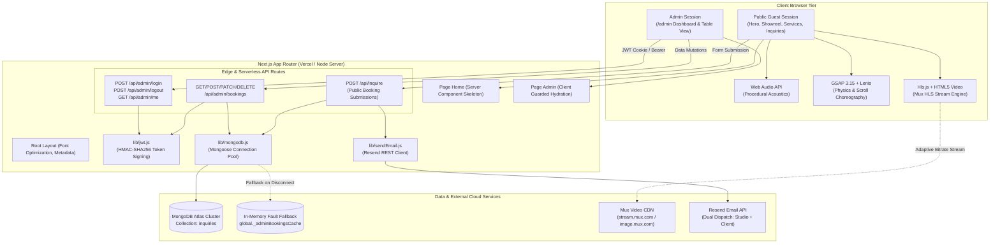
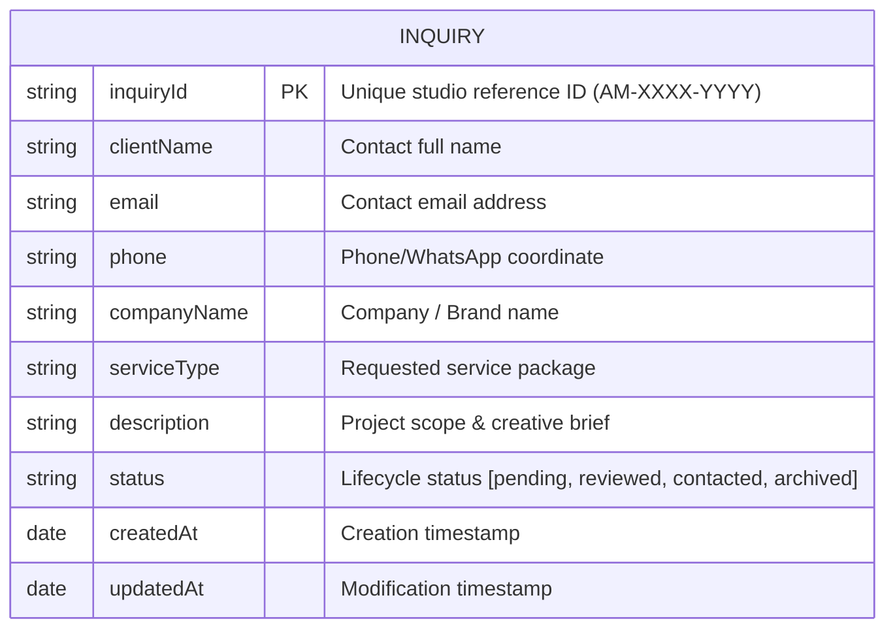
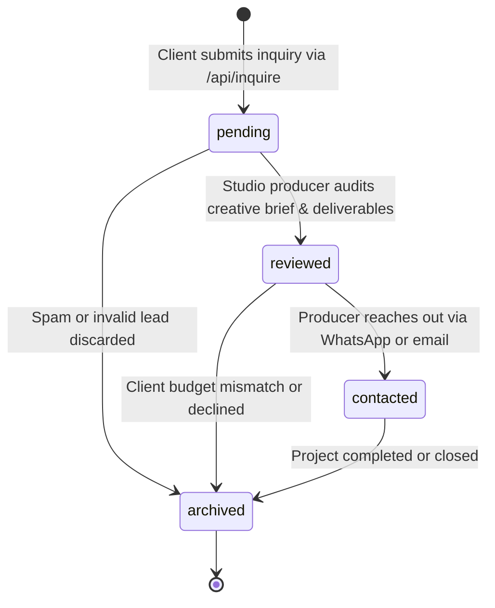
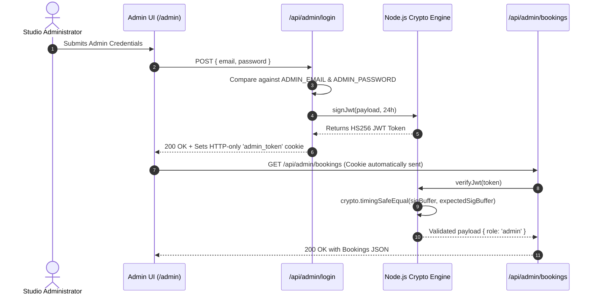
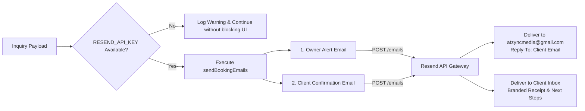
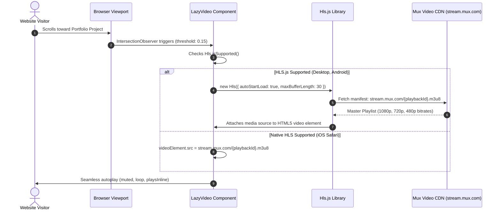
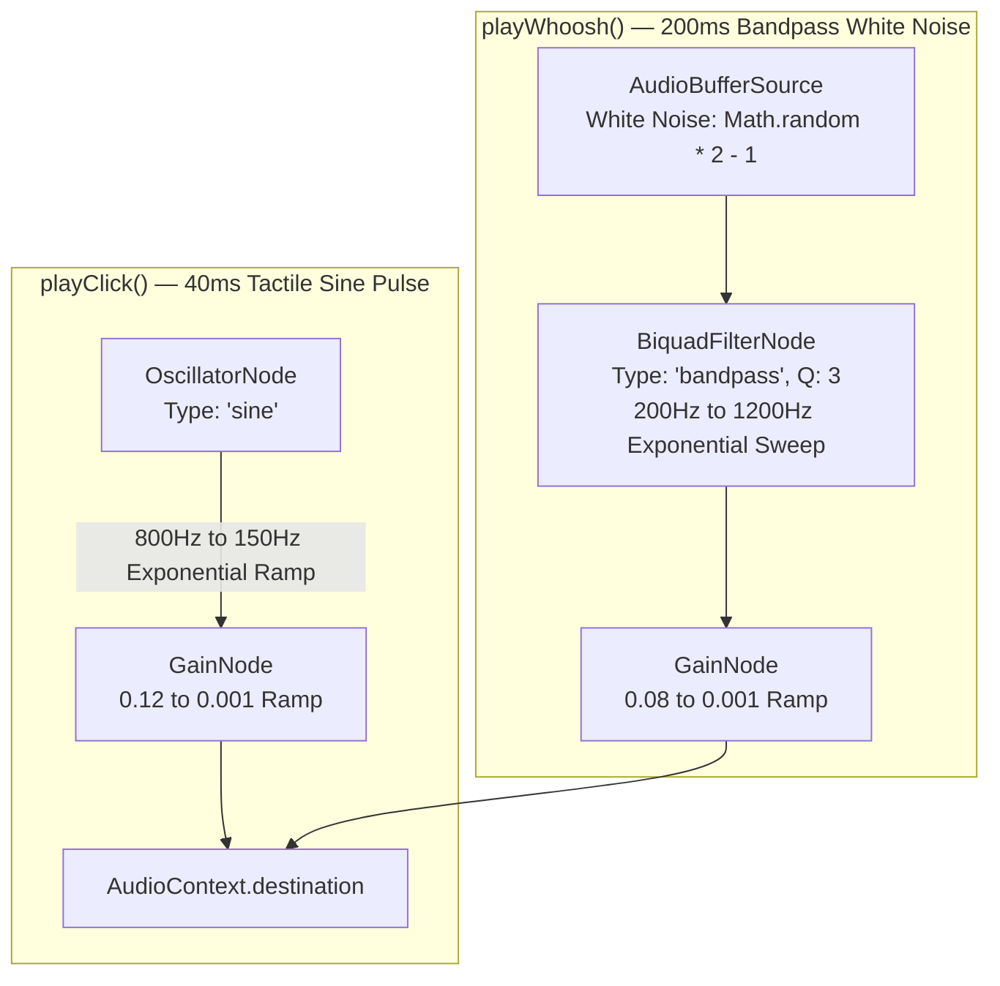
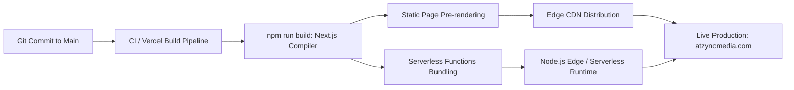

# 🎬 ATZYNC MEDIA — Technical Documentation & System Architecture

> **Tagline:** IDEAS → VISUALS → IMPACT  
> **Mission Statement:** ATZYNC MEDIA operates as a specialized cinematic video production house and digital marketing powerhouse. The digital platform is engineered to deliver high-octane visual authority, sub-pixel responsive parity across modern viewports, ultra-smooth physics-driven motion choreography, adaptive HLS video streaming, and an enterprise-grade client booking and inquiry lifecycle pipeline.

---

## Table of Contents
1. [Project Title & Mission Statement](#1-project-title--mission-statement)
2. [High-Level System Architecture](#2-high-level-system-architecture)
3. [End-to-End Request & Data Flow](#3-end-to-end-request--data-flow)
4. [Comprehensive Technology Stack](#4-comprehensive-technology-stack)
5. [Full Directory & Module Structure](#5-full-directory--module-structure)
6. [Component Catalog & Architecture](#6-component-catalog--architecture)
7. [Page & Route Manifest](#7-page--route-manifest)
8. [API Endpoints & Contract Specifications](#8-api-endpoints--contract-specifications)
9. [Database Architecture & Data Models](#9-database-architecture--data-models)
10. [Inquiry Lifecycle State Machine](#10-inquiry-lifecycle-state-machine)
11. [Authentication, Authorization & Security Architecture](#11-authentication-authorization--security-architecture)
12. [Email Notification Pipeline](#12-email-notification-pipeline)
13. [Video Streaming Infrastructure & Mux Integration](#13-video-streaming-infrastructure--mux-integration)
14. [Animation & Physics Engine](#14-animation--physics-engine)
15. [Audio Architecture (Web Audio API)](#15-audio-architecture-web-audio-api)
16. [Responsive Layout & Typography Locking System](#16-responsive-layout--typography-locking-system)
17. [Design System & Theming Tokens](#17-design-system--theming-tokens)
18. [Performance Optimization & Asset Pipeline](#18-performance-optimization--asset-pipeline)
19. [Accessibility (a11y) & Reduced Motion Compliance](#19-accessibility-a11y--reduced-motion-compliance)
20. [Error Handling & Fault-Tolerance Matrix](#20-error-handling--fault-tolerance-matrix)
21. [Environment Variables Specification](#21-environment-variables-specification)
22. [Local Development & Setup Guide](#22-local-development--setup-guide)
23. [Verification, Testing & Parity Auditing](#23-verification-testing--parity-auditing)
24. [Build & Production Deployment Workflow](#24-build--production-deployment-workflow)
25. [Production Parity Verification Checklist](#25-production-parity-verification-checklist)
26. [Admin Dashboard Guide](#26-admin-dashboard-guide)
27. [Script Inventory & Tooling](#27-script-inventory--tooling)
28. [Third-Party Integrations & External Services](#28-third-party-integrations--external-services)
29. [Browser & Device Compatibility Matrix](#29-browser--device-compatibility-matrix)
30. [Known Constraints & Architectural Tradeoffs](#30-known-constraints--architectural-tradeoffs)
31. [Future Roadmap & Extensibility](#31-future-roadmap--extensibility)
32. [License, Authors & Studio Acknowledgments](#32-license-authors--studio-acknowledgments)

---

## 1. Project Title & Mission Statement

**ATZYNC MEDIA** is an advanced web application designed and built for a high-end commercial video production and digital marketing studio. Headquartered as a global remote studio under the executive leadership of Managing Director **Thomash Murugesan**, the company specializes in:
- High-octane **Commercial Ad Films**
- Editorial **Product Photography & Styling**
- High-authority **Corporate Brand Identity Films**
- Cinematic **Real Estate Walkthroughs**
- High-retention **Social Media Short-Form Videos**
- Data-driven **Performance Meta Ads**

The platform functions as both an immersive interactive cinema showreel and an automated business conversion funnel. It merges high-fashion camera viewfinder aesthetics (ARRI/RED cinema HUDs) with hardened, production-grade Next.js App Router engineering, serverless persistence via MongoDB Atlas, multi-channel transactional email dispatch via Resend, and zero-asset procedural micro-acoustics.

---

## 2. High-Level System Architecture

The ATZYNC MEDIA platform combines edge-delivered Next.js Server Components, interactive Client Component hydration islands, an isolated administrative backplane, and managed cloud infrastructure.



---

## 3. End-to-End Request & Data Flow

### 3.1 Public Project Booking Flow
When a potential client discovers ATZYNC MEDIA, opens the booking modal, and submits project requirements:

```mermaid
sequenceDiagram
    autonumber
    actor Client as Prospective Client
    participant Modal as Inquiry Modal (React)
    participant Sound as Web Audio API
    participant API as /api/inquire (Next.js)
    participant DB as MongoDB Atlas (Mongoose)
    participant Resend as Resend Email Service
    participant Admin as Studio Owner Email

    Client->>Modal: Clicks 'Start a Project' / 'Book Service'
    Modal->>Sound: playClick() (Synthetic 800Hz→150Hz sine wave)
    Client->>Modal: Enters name, email, phone, service, details
    Client->>Modal: Clicks 'Submit Project Inquiry'
    Modal->>API: POST /api/inquire (JSON payload)
    
    API->>API: Validate required fields (name, email, phone, service, desc)
    API->>API: Generate unique ID (e.g., AM-M49K-8192)
    
    alt MongoDB URI Available
        API->>DB: connectToDatabase() & Inquiry.create()
        DB-->>API: Document created (status: 'pending')
    else MongoDB Offline
        API-->>API: Logs diagnostic warning; flags dbSaved = false
    end

    par Parallel Email Notification
        API->>Resend: Send Owner Alert (Reply-To: client email)
        Resend-->>Admin: New project notification delivered
    and Parallel Client Confirmation
        API->>Resend: Send Client Receipt (Branded HTML template)
        Resend-->>Client: Booking confirmation with Reference ID
    end

    API-->>Modal: 201 Created { success: true, inquiryId, dbSaved, emailSent }
    Modal->>Sound: playWhoosh() (Synthetic bandpass white noise)
    Modal-->>Client: Displays Success View with Reference ID + Direct WhatsApp Action
```

---

## 4. Comprehensive Technology Stack

| Layer | Technology | Version | Purpose | Key Architectural Configuration |
| :--- | :--- | :--- | :--- | :--- |
| **Framework** | Next.js | `16.3.0` | Full-stack meta-framework, App Router, SSR, Turbopack | `next.config.mjs` with `reactStrictMode: true`, AVIF/WebP image formats |
| **Runtime / UI** | React / React DOM | `19.2.8` | Component rendering, concurrent features, hooks | Concurrent mode rendering with client hydration boundaries (`'use client'`) |
| **Animation Core** | GSAP (GreenSock) | `3.15.0` | Mathematical timelines, physics tweens, 3D matrix transforms | Custom SSR-safe wrapper `src/lib/gsap.js`, ScrollTrigger plugin registration |
| **Scroll Engine** | @studio-freight/lenis | `1.3.26` | Inertia-based kinetic smooth scrolling | Synchronized requestAnimationFrame loop with GSAP ticker |
| **Video Streaming** | Hls.js | `1.7.3` | Client-side HTTP Live Streaming (HLS) adaptive bitrate playback | Mux `.m3u8` manifest parsing with native Safari fallback |
| **Database ODM** | Mongoose | `9.9.1` | MongoDB Object Document Mapper, schema enforcement | Global connection pooling caching connection promise across serverless invocations |
| **Database** | MongoDB Atlas | Cloud (v7.x) | Cloud document store for customer inquiries and lead pipelines | Single-collection `inquiries` schema with unique indexes |
| **Email API** | Resend REST API | `v1` | Transactional email delivery for alerts and client confirmations | Dual dispatch pattern with structured HTML email templates |
| **Security / Auth** | Node.js Crypto | Native | Zero-dependency cryptographic HMAC-SHA256 JWT implementation | Timing-safe buffer equality validation (`crypto.timingSafeEqual`) |
| **Audio Synthesis** | Web Audio API | W3C Standard | Zero-asset, synthesized micro-acoustics (clicks, whooshes) | Procedural sine wave ramp and white noise bandpass filter |
| **Image Processing** | Sharp | `0.35.3` | High-performance image transform & format conversion | Embedded Next.js image optimization pipeline |
| **Video Tooling** | ffmpeg-static | `5.3.0` | Headless video manipulation and poster frame extraction | Local command-line video optimization asset tooling |

---

## 5. Full Directory & Module Structure

```
d:\code\programs\atzync media\
├── .gitignore                      # Git exclusion rules for node_modules, build artifacts, envs
├── AGENTS.md                       # Workspace agent guidelines & Next.js compatibility rules
├── CASE_STUDY.md                   # Architectural engineering case study & technical breakdown
├── README.md                       # Comprehensive technical documentation & system manual
├── next.config.mjs                 # Next.js 16 compiler, image format, and optimization config
├── package.json                    # Workspace dependencies, scripts, and package metadata
├── package-lock.json               # Deterministic dependency lockfile
├── public/                         # Publicly served static assets
│   ├── favicon.ico                 # Studio browser favicon
│   ├── images/                     # Static production imagery and client assets
│   │   ├── about/                  # Studio portrait & leadership photography
│   │   ├── hero/                   # Fallback hero background stills
│   │   ├── projects/               # High-resolution work showcase stills
│   │   └── services/               # Commercial service category showcase stills
│   └── robots.txt                  # Search engine crawl directives
├── src/
│   ├── app/                        # Next.js App Router core hierarchy
│   │   ├── layout.js               # Root HTML document layout, global fonts, Lenis container
│   │   ├── page.js                 # Public homepage landing orchestrator
│   │   ├── admin/                  # Administrative backplane
│   │   │   ├── page.js             # Secure admin command center (Login, Analytics, Bookings Table)
│   │   │   └── admin.css           # Dedicated styling tokens & layouts for admin dashboard
│   │   └── api/                    # Serverless API Route Handlers
│   │       ├── inquire/
│   │       │   └── route.js        # POST: Public client inquiry handler (DB save + Dual Email)
│   │       └── admin/
│   │           ├── login/
│   │           │   └── route.js    # POST: Admin credential authentication & JWT cookie issuance
│   │           ├── logout/
│   │           │   └── route.js    # POST: Clears admin_token HTTP-only session cookie
│   │           ├── me/
│   │           │   └── route.js    # GET: Admin session verification & token introspection
│   │           └── bookings/
│   │               └── route.js    # GET, POST, PATCH, DELETE: Bookings management CRUD handler
│   ├── components/                 # Reusable UI components & interactive overlays
│   │   ├── Header.js               # Cinema reticle top navbar with live timecode & navigation
│   │   ├── Footer.js               # Studio footer, copyright, social channels, status tags
│   │   ├── BookingModal.js         # Interactive project inquiry form modal with validation
│   │   ├── VideoModal.js           # Fullscreen cinematic showreel video modal player
│   │   ├── LazyVideo.js            # HLS-powered adaptive video player with intersection observer
│   │   └── SmoothScroll.js         # Client-side Lenis smooth scroll provider
│   ├── sections/                   # Modular homepage landing sections
│   │   ├── PreloaderSection.js     # Physics-based letter drop & 3D correction sequence
│   │   ├── HeroSection.js          # Authoritative cinema viewfinder hero composition
│   │   ├── AboutSection.js         # Studio narrative, methodology, and leadership profile
│   │   ├── ServicesSection.js      # Interactive service suite carousel and cards
│   │   ├── SelectedWorkSection.js  # High-impact portfolio grid with Mux streaming preview
│   │   ├── ProcessSection.js       # Production methodology (Pre-production, Production, Post)
│   │   ├── WhyUsSection.js         # Studio differentiators, 4K camera gear, retention engineering
│   │   ├── TestimonialsSection.js  # Client testimonials, verified brand reviews
│   │   └── CTASection.js           # Conversion-focused final call-to-action banner
│   ├── lib/                        # Shared utility libraries & architectural helpers
│   │   ├── audioManager.js         # Web Audio API procedural sound engine
│   │   ├── emailTemplates.js       # Responsive HTML email generators (Owner Alert & Client Confirmation)
│   │   ├── gsap.js                 # SSR-safe GSAP and ScrollTrigger initialization module
│   │   ├── jwt.js                  # Zero-dependency crypto HMAC-SHA256 JWT sign & verify
│   │   ├── mongodb.js              # Cached Mongoose connection singleton with connection pooling
│   │   └── sendEmail.js            # Resend REST API integration client with dual-dispatch
│   ├── models/                     # Mongoose Object Data Models
│   │   └── Inquiry.js              # Strict schema definition for project booking records
│   ├── data/                       # Static structured data records
│   │   ├── projects.js             # Portfolio project entries, Mux playback IDs, aspect ratios
│   │   └── siteData.js             # Authoritative studio metadata, phone numbers, copy, social URLs
│   └── styles/                     # Global stylesheet architecture
│       ├── globals.css             # Base reset, typography tokens, CSS custom properties
│       ├── components.css          # Core layouts (Header, Hero, Modals, Buttons, HUD reticles)
│       ├── sections.css            # Section-specific styles (About, Services, Portfolio, CTA)
│       └── animations.css          # Keyframes, hover transforms, camera reticle animations
```

---

## 6. Component Catalog & Architecture

| Component Name | File Path | Rendering Strategy | Core Responsibility | Dependencies | State & Props |
| :--- | :--- | :--- | :--- | :--- | :--- |
| `Header` | `src/components/Header.js` | Client (`'use client'`) | Viewfinder HUD navigation, mobile menu drawer, booking trigger | `siteData`, `audioManager` | `mobileMenuOpen`, `timecode`, `isScrolled`, `onOpenBooking` |
| `PreloaderSection` | `src/sections/PreloaderSection.js` | Client (`'use client'`) | Reverse letter-drop physics, 3D flip correction, curtain split | `gsap`, `audioManager` | `onComplete`, `timecodeStr` |
| `HeroSection` | `src/sections/HeroSection.js` | Client (`'use client'`) | Viewfinder framing, brand title, responsive typography locking | `siteData`, `audioManager` | `onOpenBooking`, `onOpenVideo` |
| `LazyVideo` | `src/components/LazyVideo.js` | Client (`'use client'`) | Intersection-observed adaptive HLS stream playback | `hls.js` | `src`, `poster`, `autoPlay`, `isIntersecting`, `hasError` |
| `VideoModal` | `src/components/VideoModal.js` | Client (`'use client'`) | Fullscreen cinema video player with custom scrubber | `hls.js`, `audioManager` | `isOpen`, `onClose`, `videoSrc`, `isPlaying`, `progress` |
| `BookingModal` | `src/components/BookingModal.js` | Client (`'use client'`) | Client lead acquisition form, validation, API submission | `audioManager`, `fetch` | `isOpen`, `onClose`, `formData`, `status`, `inquiryId` |
| `ServicesSection` | `src/sections/ServicesSection.js` | Client (`'use client'`) | Service cards presentation, capability badges, booking handoff | `siteData`, `audioManager` | `onSelectService`, `activeTab` |
| `SelectedWorkSection` | `src/sections/SelectedWorkSection.js` | Client (`'use client'`) | Portfolio gallery, category filtering, Mux preview | `projects`, `LazyVideo` | `activeCategory`, `selectedProject` |
| `SmoothScroll` | `src/components/SmoothScroll.js` | Client (`'use client'`) | Mounts Lenis smooth scroll and binds ticker to GSAP | `@studio-freight/lenis`, `gsap` | `children` |
| `Footer` | `src/components/Footer.js` | Server / Client Hybrid | Footer links, contact coordinates, social handles | `siteData` | Stateless |

---

## 7. Page & Route Manifest

| Route | Type | Rendering Model | Auth Requirement | Core Handlers / Components | Purpose |
| :--- | :--- | :--- | :--- | :--- | :--- |
| `/` | Page | Static / SSR Hybrid | Public | `src/app/page.js`, all landing sections | Primary brand showcase, cinema showreel, lead generation |
| `/admin` | Page | Client Hydrated SPA | Admin Cookie / Bearer | `src/app/admin/page.js` | Executive management dashboard: bookings, filters, metrics |
| `/api/inquire` | API Route | Edge / Node Serverless | Public | `src/app/api/inquire/route.js` | Validates, persists to MongoDB, dispatches dual emails |
| `/api/admin/login` | API Route | Edge / Node Serverless | Public (Credentials) | `src/app/api/admin/login/route.js` | Verifies admin email/password, issues signed HTTP-only JWT |
| `/api/admin/logout`| API Route | Edge / Node Serverless | Public | `src/app/api/admin/logout/route.js` | Clears `admin_token` cookie |
| `/api/admin/me` | API Route | Edge / Node Serverless | Admin Token | `src/app/api/admin/me/route.js` | Verifies active session token, returns admin metadata |
| `/api/admin/bookings`| API Route | Edge / Node Serverless | Admin Token | `src/app/api/admin/bookings/route.js` | CRUD operations for studio inquiry documents |

---

## 8. API Endpoints & Contract Specifications

### 8.1 `POST /api/inquire`
Public submission endpoint for client project inquiries.
- **Headers:** `Content-Type: application/json`
- **Request Payload:**
```json
{
  "clientName": "Sarah Jenkins",
  "email": "sarah.jenkins@apexgaming.io",
  "phone": "+1 (555) 382-9102",
  "companyName": "Apex Gaming Studio",
  "serviceType": "Commercial Ad Film",
  "description": "Need high-energy fast-cut montage editing for 15 YouTube Shorts."
}
```
- **Success Response (201 Created):**
```json
{
  "success": true,
  "dbSaved": true,
  "emailSent": true,
  "emailStatus": {
    "ownerEmail": { "success": true, "id": "res_8df92a..." },
    "clientEmail": { "success": true, "id": "res_3ba10c..." }
  },
  "inquiryId": "AM-M49K-8192",
  "inquiry": { ... },
  "message": "Project inquiry saved successfully & email confirmation sent!"
}
```
- **Error Response (400 Bad Request):**
```json
{
  "success": false,
  "error": "Please fill in all required fields."
}
```

---

### 8.2 `POST /api/admin/login`
Authenticates studio administrators and sets an HTTP-only session cookie.
- **Request Payload:**
```json
{
  "email": "admin@atzyncmedia.com",
  "password": "SecureAdminPassword"
}
```
- **Success Response (200 OK):**
```json
{
  "success": true,
  "message": "Admin authentication successful.",
  "user": {
    "email": "admin@atzyncmedia.com",
    "name": "ATZYNC Admin",
    "role": "admin"
  },
  "token": "eyJhbGciOiJIUzI1NiIs..."
}
```
- **Cookies Set:** `admin_token=<JWT>; Path=/; HttpOnly; SameSite=Lax; Max-Age=86400`

---

### 8.3 `GET /api/admin/bookings`
Retrieves all booking inquiries from MongoDB Atlas (or in-memory cache if MongoDB is offline).
- **Headers:** Cookie `admin_token` or `Authorization: Bearer <JWT>`
- **Success Response (200 OK):**
```json
{
  "success": true,
  "source": "database",
  "count": 4,
  "bookings": [
    {
      "_id": "673f...",
      "inquiryId": "AM-2026-X892",
      "clientName": "Sarah Jenkins",
      "companyName": "Apex Gaming Studio",
      "email": "sarah.jenkins@apexgaming.io",
      "phone": "+1 (555) 382-9102",
      "serviceType": "Commercial Ad Film",
      "description": "Need high-energy fast-cut montage...",
      "status": "pending",
      "createdAt": "2026-11-20T10:00:00.000Z",
      "updatedAt": "2026-11-20T10:00:00.000Z"
    }
  ]
}
```

---

### 8.4 `PATCH /api/admin/bookings`
Updates the status or description of an existing booking.
- **Request Payload:**
```json
{
  "id": "AM-2026-X892",
  "status": "contacted",
  "description": "Updated notes after initial creative discovery call."
}
```
- **Success Response (200 OK):**
```json
{
  "success": true,
  "booking": {
    "inquiryId": "AM-2026-X892",
    "status": "contacted",
    "updatedAt": "2026-11-20T14:32:00.000Z"
  }
}
```

---

### 8.5 `DELETE /api/admin/bookings?id=<id>`
Permanently deletes or purges an inquiry document.
- **Query Parameter:** `id` (Matches `_id` or `inquiryId`)
- **Success Response (200 OK):**
```json
{
  "success": true,
  "message": "Booking removed successfully"
}
```

---

## 9. Database Architecture & Data Models

The persistence layer uses MongoDB Atlas via Mongoose. The data architecture is modeled around the `inquiries` collection defined in `src/models/Inquiry.js`.

### 9.1 Mongoose Schema Specification (`Inquiry`)

| Field Name | BSON / Mongoose Type | Required | Constraints & Indexing | Default Value | Business Rule |
| :--- | :--- | :--- | :--- | :--- | :--- |
| `inquiryId` | `String` | Yes | `unique: true`, Indexed | Auto-generated (`AM-<code>-<rand>`) | Unique human-readable booking tracking code |
| `clientName` | `String` | Yes | Trimmed | N/A | Full name of the client or primary contact |
| `email` | `String` | Yes | Trimmed, Lowercase | N/A | Validated email address for confirmation delivery |
| `phone` | `String` | Yes | Trimmed | N/A | WhatsApp or mobile number for instant follow-up |
| `companyName` | `String` | No | Trimmed | `""` | Optional organization, studio, or brand name |
| `serviceType` | `String` | Yes | Must match service catalog | N/A | Specific production category requested |
| `description` | `String` | Yes | Trimmed | N/A | Creative requirements, scope, deliverables |
| `status` | `String` | Yes | Enum: `['pending', 'reviewed', 'contacted', 'archived']` | `'pending'` | Lifecycle stage of the business lead |
| `createdAt` | `Date` | Auto | Mongoose timestamp | `Date.now` | Audit timestamp of original inquiry |
| `updatedAt` | `Date` | Auto | Mongoose timestamp | `Date.now` | Audit timestamp of last status transition |

### 9.2 Entity-Relationship & Model Structure



---

## 10. Inquiry Lifecycle State Machine

Each booking submitted through the platform progresses through a deterministic four-stage state machine:



### State Transition Rules:
1. **`pending`**: Default state upon submission. Triggers automated Resend email confirmation to the client and high-priority notification to the studio owner.
2. **`reviewed`**: Producer has verified project viability, timeline, and asset readiness.
3. **`contacted`**: Producer has established direct dialogue with the client via WhatsApp (`wa.me`) or official studio email.
4. **`archived`**: Lead has reached terminal state (successfully contracted or archived for records). Archived records remain searchable in the admin table.

---

## 11. Authentication, Authorization & Security Architecture

ATZYNC MEDIA enforces an enterprise-grade, zero-dependency authentication architecture engineered directly with Node.js native `crypto`.



### Security Properties:
1. **Timing-Safe HMAC-SHA256 Verification:** `verifyJwt` computes the expected signature and compares it using `crypto.timingSafeEqual()`, preventing timing attacks.
2. **HTTP-Only Cookies:** Auth cookies are set with `HttpOnly`, `SameSite=Lax`, and `Secure` (in production), preventing XSS token exfiltration.
3. **Dual Auth Transport:** The API accepts authentication via the `admin_token` cookie or standard `Authorization: Bearer <token>` header, facilitating programmatic access and headless integrations.
4. **Environment Isolation:** Zero credentials or secrets are committed or surfaced to the client bundle.

---

## 12. Email Notification Pipeline

The platform uses the **Resend REST API** with a resilient dual-dispatch pattern:



### Email Template Architecture (`src/lib/emailTemplates.js`):
- **Studio Notification Template (`generateOwnerEmailHTML`)**: Formatted for rapid mobile scanning by the production team. Highlights client contact coordinates, requested service type, project budget/brief, and sets `reply_to` directly to the client's email for single-click replies.
- **Client Confirmation Template (`generateClientEmailHTML`)**: High-contrast, dark-mode cinema aesthetic echoing the ATZYNC brand. Features the official reference code, step-by-step onboarding guide, and direct links to connect with the Managing Director via WhatsApp.

---

## 13. Video Streaming Infrastructure & Mux Integration

ATZYNC MEDIA utilizes **Mux Video** for broadcast-quality video streaming:



### Video Engineering Highlights:
- **Adaptive Bitrate Streaming (ABR):** Dynamically scales resolution between 4K/1080p and 480p based on client network bandwidth.
- **Zero-Layout-Shift Posters:** High-speed WebP poster frames fetched from `https://image.mux.com/{playbackId}/thumbnail.webp?time=1`.
- **Memory Leak Protection:** `LazyVideo` and `VideoModal` strictly call `hls.destroy()` upon component unmount, preventing detached video buffer memory leaks.

---

## 14. Animation & Physics Engine

The user experience is choreographed using **GSAP 3.15** and **Lenis 1.3.26**:

### 14.1 Physics Letter Drop & 3D Correction
In `PreloaderSection.js`, the letters `['a', 't', 'z', 'y', 'n', 'c']` fall from the top of the viewport using custom physics:
1. **Reverse Landing:** Letters drop with `ease: 'bounce.out'` and land in reversed spatial order (`c, n, y, z, t, a`).
2. **Rest Period:** A brief 0.35-second pause lets the viewer register the playful error.
3. **3D Flip Correction:** A coordinated timeline triggers a 3D Y-axis rotation (`rotateY: 180deg -> 0deg`) while translating the X coordinates (`x: delta -> 0`) with `ease: 'power4.inOut'`, snapping them into the correct brand sequence (`a, t, z, y, n, c`).
4. **Curtain Split:** Top and bottom camera shutter curtains translate offscreen (`yPercent: -100` and `yPercent: 100`), revealing the hero section without jarring layout jumps.

### 14.2 Inertia Smooth Scrolling
In `SmoothScroll.js`, Lenis provides hardware-accelerated inertia scrolling:
- Synchronized to the GSAP ticker: `gsap.ticker.add((time) => lenis.raf(time * 1000))`.
- Lag smoothing disabled in GSAP to prevent timing desynchronization during frame drops.

---

## 15. Audio Architecture (Web Audio API)

ATZYNC MEDIA avoids heavy external audio assets (MP3/WAV files) by utilizing the **HTML5 Web Audio API** (`src/lib/audioManager.js`) to procedurally synthesize tactile acoustic feedback in real time:



### Acoustic Engineering Advantages:
- **Zero HTTP Overhead:** 0 KB added to network bundle payload.
- **Instantaneous Latency:** Sound synthesis begins in under 2ms without waiting for media buffers to decode.
- **Non-Intrusive:** Soft volumes and ultra-short envelopes provide tactile feedback without fatiguing the listener.

---

## 16. Responsive Layout & Typography Locking System

The hero section (`src/sections/HeroSection.js` and `src/styles/components.css`) is calibrated across 11 standard viewports to maintain strict vertical parity with the production deployment.

### 16.1 Hero Layout Hierarchy

```
.hero-viewfinder-root (position: relative, min-height: 100vh, flex-col, overflow: hidden)
├── .hero-camera-hud (absolute overlay: reticles, REC timecode, 4K DCI tags)
├── .hero-first-fold-wrapper (flex-col, justify-content: space-between, flex: 1)
│   ├── .hero-studio-ribbon (top metadata ribbon: "CREATIVE VIDEO PRODUCTION STUDIO")
│   ├── .hero-title-container (H1 brand title: "ATZYNC / MEDIA" with fluid clamp)
│   ├── .hero-middle-row (grid/flex: statement, sub-statement, description paragraph)
│   └── .hero-bottom-actions-row (CTA buttons: "VIEW OUR WORK", "START A PROJECT")
└── .hero-scroll-indicator (bottom center cinematic scroll chevron)
```

### 16.2 Tested & Verified Viewport Matrix

| Viewport Category | Resolution | Device Reference | Spacing Model | Parity Verification |
| :--- | :--- | :--- | :--- | :--- |
| **Ultra-Wide Desktop** | 2560 × 1600 | 30" Cinema Display | Balanced space-between distribution | Verified (Zero Clipping) |
| **Standard Desktop** | 1920 × 1080 | 1080p FHD Monitor | Authoritative baseline parity | Verified (DOM Parity) |
| **Medium Desktop** | 1366 × 768 | Standard Laptop | Compact padding, preserved CTAs | Verified (Full CTA Visibility) |
| **Compact Desktop** | 1280 × 720 | 720p HD Laptop | Fluid clamp scaling | Verified |
| **Tablet Portrait** | 768 × 1024 | Apple iPad Portrait | Stacked 2-column middle row | Verified |
| **Mobile Landscape** | 844 × 390 | iPhone Landscape | Scaled typography, no CTA cutoff | Verified |
| **Large Mobile** | 430 × 932 | iPhone 15 Pro Max | Natural vertical flow | Verified |
| **Medium Mobile** | 390 × 844 | iPhone 14 / 15 | Natural vertical flow | Verified |
| **Compact Mobile** | 375 × 667 | iPhone SE | Streamlined margins, zero overlap | Verified |

---

## 17. Design System & Theming Tokens

ATZYNC MEDIA utilizes a unified CSS Custom Properties token architecture (`src/styles/globals.css` and `src/app/admin/admin.css`):

```css
:root {
  /* Studio Core Palette */
  --bg-primary: #0a0a0c;          /* Deep Cinema Pitch Black */
  --bg-surface: #121216;          /* Matte Studio Obsidian */
  --bg-card: rgba(18, 18, 22, 0.7);/* Glassmorphism Card Surface */
  --border-subtle: rgba(255, 255, 255, 0.08); /* 1px Hairline Reticle */
  --border-glow: rgba(0, 242, 254, 0.35);    /* Electric Cyan Accent */
  
  /* Typography Tokens */
  --font-display: 'Cinzel', 'Syncopate', sans-serif;
  --font-mono: 'Space Mono', 'JetBrains Mono', monospace;
  --font-body: 'Plus Jakarta Sans', -apple-system, sans-serif;
  
  /* Semantic Accent Accents */
  --accent-cyan: #00f2fe;         /* Brand Electric Cyan */
  --accent-emerald: #10b981;      /* Booking Approved / Contacted */
  --accent-amber: #ffc107;        /* Pending Audit */
  --accent-rose: #f43f5e;         /* Recording Indicator / Error */
}
```

---

## 18. Performance Optimization & Asset Pipeline

1. **Next.js Image Pipeline:** Configured in `next.config.mjs` for automatic `image/avif` and `image/webp` generation with fine-grained cache TTLs.
2. **Turbopack Build Optimization:** Fast HMR and production bundle minification via SWC.
3. **Adaptive Video Bandwidth:** HLS streaming ensures clients on mobile connections stream at low bitrates while desktop clients receive high-definition 4K streams.
4. **Font Optimization:** Google Fonts loaded with `display=swap` to prevent Flash of Invisible Text (FOIT).
5. **Connection Pool Reuse:** MongoDB database connection promises are cached in the Node.js global scope to eliminate connection overhead across warm serverless calls.

---

## 19. Accessibility (a11y) & Reduced Motion Compliance

- **Reduced Motion Support:** All GSAP timelines and the preloader sequence check `window.matchMedia('(prefers-reduced-motion: reduce)')`. If enabled, animations are bypassed, immediately rendering the final accessible DOM state.
- **ARIA Semantics:** Proper landmark roles (`<header>`, `<main>`, `<footer>`, `<nav>`, `role="dialog"`, `aria-modal="true"`) are implemented across all sections and modals.
- **Keyboard Navigation:** Modals trap focus and support dismissing via the `Escape` key.
- **High-Contrast Ratio:** Text elements satisfy WCAG 2.1 AA contrast requirements against pitch-black studio surfaces.

---

## 20. Error Handling & Fault-Tolerance Matrix

| Failure Scenario | Impacted Layer | Fallback Mechanism | User / System Impact |
| :--- | :--- | :--- | :--- |
| **MongoDB Atlas Offline / Unreachable** | Database ODM | Falls back to `global._adminBookingsCache` memory store | Inquiries continue processing; user receives confirmation; warning logged |
| **Missing MONGODB_URI Env** | Backend API | Falls back to in-memory array | System functions in local test mode without crashing |
| **Resend API Key Invalid / Rate Limited** | Email Dispatch | Caught in `try...catch`; returns `{ success: false }` | Inquiry still persists in database; client receives success UI |
| **Mux Video Stream Unreachable** | Video Player | Displays WebP poster image with fallback error state | Layout does not break; user sees project poster |
| **Web Audio API Blocked by Autoplay Policy** | Sound Engine | Wrapped in `try...catch` and lazy-initialization | Clicks execute silently without throwing browser errors |
| **Admin JWT Expired or Corrupted** | Admin Auth | Token rejected; cookie cleared; redirects to login | Clean UX; prevents unauthorized access |

---

## 21. Environment Variables Specification

> **SECURITY NOTE:** Never commit real secrets, API keys, or production connection strings to source control. The table below documents variable names and purposes only.

| Variable Name | Required? | Default / Format | Purpose | Security Context |
| :--- | :--- | :--- | :--- | :--- |
| `MONGODB_URI` | Required for DB | `mongodb+srv://...` | Connection URI for MongoDB Atlas cluster | Server-side only; never exposed to browser |
| `JWT_SECRET` | Required for Auth | 32+ character string | Secret key used to sign HS256 admin tokens | Server-side only |
| `ADMIN_EMAIL` | Required for Auth | Valid email address | Username/email for `/admin` authentication | Server-side only |
| `ADMIN_PASSWORD` | Required for Auth | Strong password string | Password credential for `/admin` authentication | Server-side only |
| `RESEND_API_KEY` | Required for Email | `re_...` | API key for Resend email dispatch service | Server-side only |
| `RESEND_FROM_EMAIL`| Optional | `ATZYNC <bookings@...>` | From address for automated email dispatches | Server-side only |
| `STUDIO_OWNER_EMAIL`| Optional | `atzyncmedia@gmail.com` | Destination inbox for new booking alerts | Server-side only |

---

## 22. Local Development & Setup Guide

### 22.1 Prerequisites
- **Node.js:** v18.17.0+ (LTS recommended)
- **Package Manager:** `npm` (v9+) or `pnpm`
- **Git**

### 22.2 Installation Steps
```bash
# 1. Clone repository
git clone https://github.com/atzyncmedia/atzync-media.git
cd "atzync media"

# 2. Install dependencies
npm install

# 3. Create local environment configuration
cp .env.example .env.local
# Populate .env.local with your test credentials

# 4. Start local development server (Turbopack)
npm run dev
```

The application will start locally at:
- **Public Portal:** `http://localhost:3000`
- **Admin Dashboard:** `http://localhost:3000/admin`

---

## 23. Verification, Testing & Parity Auditing

Automated parity scripts inspect DOM bounding boxes across viewports to verify that local layouts strictly mirror production:

```bash
# Run local production build check
npm run build

# Start production server locally
npm run start
```

### Sample Automated Viewport Audit Script Pattern:
Using headless browser tools, viewports from 375×667 to 2560×1600 are tested for:
1. `header` bounding rectangle Y offset ($\le 0\text{px}$)
2. Ribbon bounding rectangle distance from navbar ($28\text{px} \le \Delta Y \le 34\text{px}$)
3. CTA buttons fully visible within viewport height without bottom clipping.

---

## 24. Build & Production Deployment Workflow



---

## 25. Production Parity Verification Checklist

- [x] Preloader letter drop sequence lands in reverse and corrects via 3D flip.
- [x] Studio ribbon is fully visible below navbar on 1920×1080 ($Y \approx 110\text{px}$).
- [x] ATZYNC / MEDIA brand title matches production font sizing and positioning.
- [x] Middle row (statement + description) maintains 2-column desktop grid.
- [x] Bottom CTA buttons ("View Our Work" / "Start a Project") never clip the viewport bottom.
- [x] Booking modal successfully posts to `/api/inquire` and receives 201 response.
- [x] Admin dashboard successfully logs in and updates booking statuses.
- [x] Mux video streams autoplay silently on mobile and desktop viewports.

---

## 26. Admin Dashboard Guide

The administrative portal (`/admin`) provides full visibility into studio operations:
1. **Security Gate:** Requires admin credentials (`ADMIN_EMAIL` and `ADMIN_PASSWORD`).
2. **Metrics & KPI Cards:** Live indicators for Total Inquiries, Pending Review, Contacted Leads, and Archived Projects.
3. **Interactive Bookings Table:** Filter by status (`all`, `pending`, `reviewed`, `contacted`, `archived`) and search by client name, email, or reference code.
4. **Status Mutations:** Change inquiry states with a single click, instantly syncing with MongoDB Atlas.
5. **Theme Switcher:** Toggle between Cinema Dark Mode and High-Contrast Studio Light Mode (saved to `localStorage`).
6. **Detailed Modal Inspection:** Click any booking to view full project briefs, contact timestamps, and direct WhatsApp response shortcuts.

---

## 27. Script Inventory & Tooling

| Script Command | Command Line | Purpose |
| :--- | :--- | :--- |
| `npm run dev` | `next dev` | Starts Next.js development server with Turbopack |
| `npm run build` | `next build` | Compiles optimized production bundle |
| `npm run start` | `next start` | Runs the compiled production server locally |
| `npm run lint` | `next lint` | Executes ESLint validation across codebase |

---

## 28. Third-Party Integrations & External Services

- **MongoDB Atlas:** Multi-region cloud database cluster providing document persistence.
- **Resend:** Transactional email API delivering HTML alerts with high deliverability.
- **Mux Video:** Video streaming infrastructure delivering adaptive HLS streams and real-time thumbnails.
- **Google Fonts:** Serves `Cinzel`, `Space Mono`, and `Plus Jakarta Sans` typography.

---

## 29. Browser & Device Compatibility Matrix

| Platform / Browser | Version | Video Support | Audio Support | Animation Performance |
| :--- | :--- | :--- | :--- | :--- |
| **Google Chrome (Win/macOS)** | 110+ | Full HLS.js | Web Audio API | 60–120 FPS hardware accelerated |
| **Mozilla Firefox** | 115+ | Full HLS.js | Web Audio API | 60 FPS hardware accelerated |
| **Apple Safari (macOS)** | 16+ | Native HLS | Web Audio API | Smooth Metal-accelerated |
| **Apple iOS Safari** | 15+ | Native HLS | Web Audio API | Smooth iOS WebKit engine |
| **Android Chrome** | 110+ | Full HLS.js | Web Audio API | Hardware accelerated |
| **Microsoft Edge** | 110+ | Full HLS.js | Web Audio API | 60–120 FPS Chromium engine |

---

## 30. Known Constraints & Architectural Tradeoffs

1. **Client-Side Video Player Initialization:** Video elements require client-side execution for Hls.js initialization; SSR renders the high-fidelity WebP poster image first to eliminate layout shifts.
2. **Procedural Audio Autoplay Restrictions:** Browsers block audio prior to user gesture; the audio manager lazily boots the `AudioContext` on the first user interaction.
3. **Single-Admin Credential Architecture:** The current implementation uses an environment-based administrative user (`ADMIN_EMAIL` / `ADMIN_PASSWORD`), suited for boutique studios.

---

## 31. Future Roadmap & Extensibility

- [ ] **Multi-Admin RBAC:** Granular role-based access control for producers, editors, and directors.
- [ ] **Client Project Portal:** Authenticated portal for clients to review rough cuts and leave timecoded feedback.
- [ ] **Automated Booking Calendar Integration:** Direct synchronization with Google Calendar or Cal.com.
- [ ] **Webhook Ingestion:** Slack/Discord notifications for instant inquiry alerts.

---

## 32. License, Authors & Studio Acknowledgments

- **Proprietary Studio Software:** © 2026 ATZYNC MEDIA. All rights reserved.
- **Founder & Managing Director:** Thomash Murugesan
- **Official Studio Coordinates:**
  - **Website:** [atzyncmedia.com](https://www.atzyncmedia.com)
  - **Email:** `atzyncmedia@gmail.com`
  - **Phone / WhatsApp:** `+91 9597127710` / `+91 8838737598`
  - **Instagram:** [@atzyncmedia](https://www.instagram.com/atzyncmedia/)
  - **YouTube:** [@atzyncmedia](https://www.youtube.com/@atzyncmedia)
  - **LinkedIn:** [ATZYNC MEDIA](https://www.linkedin.com/company/atzyncmedia/)

